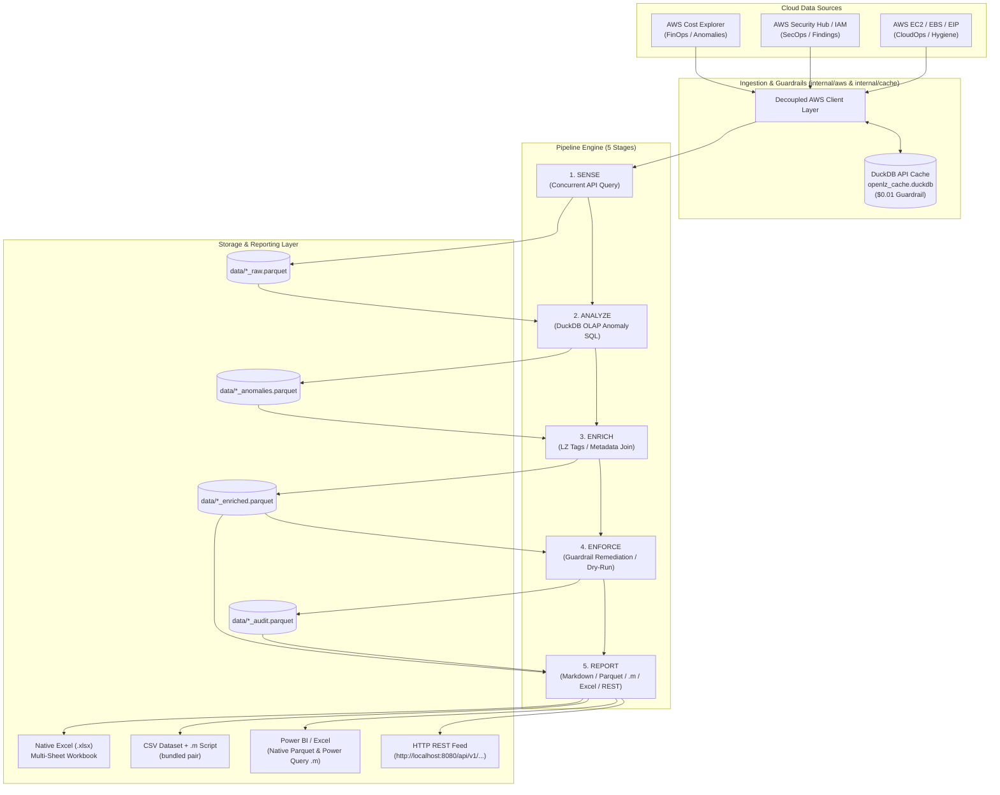
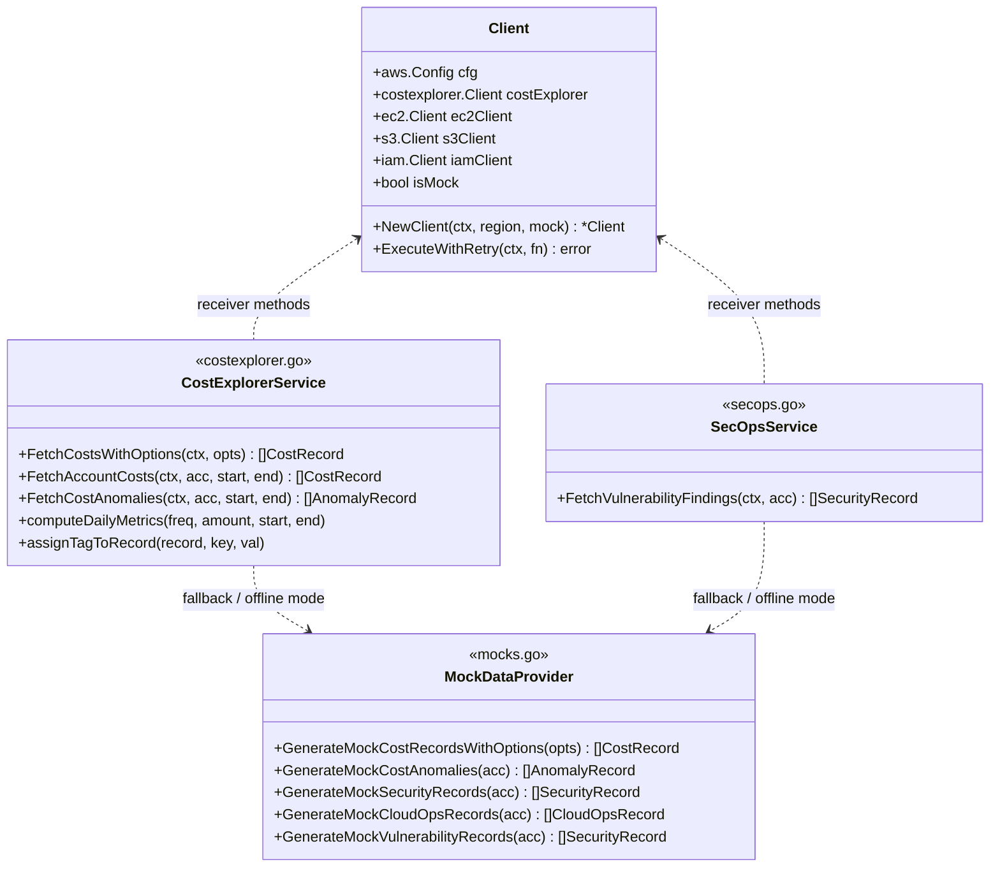
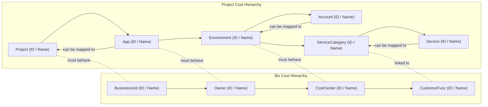

# OpenLZ Architecture

**OpenLZ (Open Landing Zone)** is a high-performance, modular, Zero-ETL Cloud Operations platform for enterprise AWS Landing Zones. It unifies **FinOps**, **SecOps**, and **CloudOps** into a single pipeline driven by an embedded [DuckDB](https://duckdb.org) engine, emitting partitioned Parquet datasets, CSV exports, native Excel workbooks (`.xlsx`), and Power Query (`.m`) feeds for Microsoft Power BI and Excel.

---

## 1. High-Level System Architecture



---

## 2. Decoupled AWS Client Architecture (`internal/aws`)

To prevent the "God Client" anti-pattern, the AWS integration layer is strictly split by domain responsibility:



- **`client.go`**: Pure SDK configuration, credential loading, regional default (`ap-southeast-1` / `us-east-1`), and resilient exponential backoff retries (`ExecuteWithRetry`).
- **`costexplorer.go`**: FinOps query builder, `LINKED_ACCOUNT` grouping, `RECORD_TYPE` discount/credit exclusion filters, Landing Zone tag parsers, and comparable daily metric normalization.
- **`secops.go`**: Security Hub and vulnerability findings querying.
- **`mocks.go`**: Offline simulation generators for all domains, fully isolated from real API query logic.

---

## 3. The 5 Pipeline Stages

Every operational domain (**FinOps**, **SecOps**, **CloudOps**) adheres to the same 5-stage lifecycle:

| Stage | Name | Responsibility | Primary Input | Primary Output |
| :--- | :--- | :--- | :--- | :--- |
| **1** | **Sense** | Concurrent query of cloud APIs or mock generators; writes raw records into DuckDB. | CLI flags / Cloud APIs | `data/*_raw.parquet` |
| **2** | **Analyze** | OLAP SQL execution in DuckDB to compute variances, deviations, spikes, and hygiene anomalies. | `*_raw.parquet` | `*_anomalies.parquet` |
| **3** | **Enrich** | Joins findings with Landing Zone governance context (BusinessUnit, Project, App, Environment, Owner). | `*_anomalies.parquet` | `*_enriched.parquet` |
| **4** | **Enforce** | Evaluates guardrail compliance; audits non-compliant resources (with `--dry-run` simulation by default). | `*_enriched.parquet` | `*_audit.parquet` |
| **5** | **Report** | Emits human-readable reports (console table, Markdown), Power Query `.m` scripts, native Excel workbooks, and HTTP REST feeds. | `*_enriched.parquet` | Markdown / Console / Excel / Power BI / REST |

---

## 4. FinOps Multi-Account Architecture

### A. Ingestion Modes
1. **Consolidated Billing Payer Mode** (`--payer-account <ID>`):
   - Queries AWS Cost Explorer from the Management/Payer account using `GroupDefinitionTypeDimension: LINKED_ACCOUNT`.
   - Avoids making hundreds of separate cross-account API calls, substantially reducing query time and AWS API cost.
2. **Individual Linked Account Mode** (`--accounts <ID1,ID2,...>`):
   - Uses `internal/workflow/scanner.go` to scan accounts concurrently via `golang.org/x/sync/errgroup` with configurable concurrency (default: 5).

### B. Landing Zone Governance Tag Grouping
Cost records are grouped by core Landing Zone tag keys:
- `BusinessUnit`
- `Project`
- `Application`
- `Environment`

Records are tagged both in structured columns (`business_unit`, `project`, `application`, `environment`) and serialized into a DuckDB `tags JSON` column for flexible ad-hoc querying.

### C. Comparable Daily Normalization (`DailyAmount`)
AWS Cost Explorer allows querying across multiple granularities (`HOURLY`, `DAILY`, `MONTHLY`) and metrics (`UnblendedCost`, `AmortizedCost`, `UsageQuantity`). To enable seamless comparisons across frequencies:

$$\text{DailyAmount} = \begin{cases} 
\text{Amount} \times 24.0 & \text{for HOURLY (24-hour run-rate baseline, } \text{DaysInPeriod} = 1/24\text{)} \\
\text{Amount} & \text{for DAILY (} \text{DaysInPeriod} = 1.0\text{)} \\
\frac{\text{Amount}}{\text{DaysInPeriod}} & \text{for MONTHLY (where } \text{DaysInPeriod} = \text{days in calendar month or elapsed days)}
\end{cases}$$

### D. Cost Hierarchy Taxonomy & Multi-Hierarchy Enrichment (Stage 3 Enrich)

Following Cost Explorer sensing (Stage 1) and OLAP variance/spike analysis (Stage 2), OpenLZ enriches cost findings against a dual-hierarchy organizational governance taxonomy: the **Biz Cost Hierarchy** and the **Project Cost Hierarchy**.

#### 1. The Dual Cost Hierarchies

```
+--------------------------------------+     +-----------------------------------------+
|          Biz Cost Hierarchy          |     |          Project Cost Hierarchy         |
+--------------------------------------+     +-----------------------------------------+
| BusinessUnit                         | <== | Project                                 |
|   +-- Owner                          | <== |   +-- App                               |
|         +-- CostCenter               | <== |         +-- Environment / Account       |
|               +-- CustomerFunc       | <== |               +-- ServiceCat / Service  |
+--------------------------------------+     +-----------------------------------------+
```



#### 2. Taxonomy Structural Relations

The taxonomy enforces two fundamental relationship primitives:

##### A. Identity Equivalence ("must behave")
Levels across the Project and Business hierarchies share 1-to-1 organizational identity. When one side is identified, the other side is guaranteed to mirror its ID and Name:
- **`ProjectID/Name` must behave `BusinessUnitID/Name`**: A Project operates as the Business Unit.
- **`AppID/Name` must behave `OwnerID/Name`**: An Application operates as the Owner entity.
- **`EnvironmentID/Name` must behave `CostCenterID/Name`**: An Environment operates as the Cost Center.

##### B. Hierarchical & Cross-Layer Lookups ("can be mapped")
These links resolve parent-child or service relationships across layers, accepting either an **ID** or a **Name**:
- **`AppID/Name` can be mapped to `ProjectID/Name`**: An App can explicitly declare its parent Project (via `projectId`), defaulting to its enclosing tree Project.
- **`AccountID/Name` can be mapped to `EnvironmentID/Name`**: An AWS Linked Account (via `environmentId` or `environmentName`) maps to an Environment/CostCenter.
- **`ServiceID/Name` can be mapped to `ServiceCatID/Name`**: An AWS service (e.g. `AmazonEC2`, `AmazonS3`) maps to its functional Service Category (e.g. `Compute`, `Storage`), which links to the underlying `CustomerFunc` (e.g. `Checkout`, `Lakehouse`).

#### 3. Enrichment Ingestion Flow (Stage 2 -> Stage 3)

1. **Input**: `data/finops_anomalies.parquet` supplies `account_id`, `account_name`, `service`, `primary_tag`, and `secondary_tag`.
2. **Resolution (`internal/taxonomy`)**:
   - `AccountID` or `AccountName` resolves `Environment` & `CostCenter` (by ID & Name).
   - `Environment` resolves `App` & `Owner` (by ID & Name).
   - `App` resolves `Project` & `BusinessUnit` (by ID & Name).
   - `Service` resolves `ServiceCategory` & `CustomerFunction` (by ID & Name).
   - If `primary_tag` or `secondary_tag` was sensed, it fills or classifies the hierarchy directly.
3. **Output**: `data/finops_enriched.parquet` contains fully populated, normalized governance columns for downstream guardrail enforcement and executive reporting:
   - `project_id`, `project`
   - `business_unit_id`, `business_unit`
   - `application_id`, `application`
   - `owner_id`, `owner`
   - `environment_id`, `environment`
   - `cost_center_id`, `cost_center`
   - `service_category_id`, `service_category`
   - `customer_function_id`, `customer_function`

---

## 5. Storage & Parquet Schemas

All intermediate and final datasets are stored as columnar Apache Parquet files generated by DuckDB's native Parquet writer.

### `raw_finops` Parquet Schema (17 Columns)

| Column | Type | Description |
| :--- | :--- | :--- |
| `account_id` | `VARCHAR` | AWS 12-digit Account ID |
| `account_name` | `VARCHAR` | Landing Zone friendly account name |
| `service` | `VARCHAR` | AWS Service name (e.g. `Amazon Elastic Compute Cloud - Compute`) |
| `usage_date` | `VARCHAR` | Date in `YYYY-MM-DD` |
| `usage_period` | `VARCHAR` | Granular period identifier (`YYYY-MM-DDTHH:00:00Z`, `YYYY-MM-DD`, `YYYY-MM`) |
| `amount` | `DOUBLE` | Raw period metric value |
| `daily_amount` | `DOUBLE` | **Normalized daily comparable cost or usage** |
| `days_in_period`| `DOUBLE` | Exact period length (`0.04167`, `1.0`, or `28.0`–`31.0`) |
| `metric` | `VARCHAR` | Metric queried (`UnblendedCost`, `AmortizedCost`, `UsageQuantity`) |
| `frequency` | `VARCHAR` | Frequency queried (`HOURLY`, `DAILY`, `MONTHLY`) |
| `unit` | `VARCHAR` | Unit of measurement (`USD`, `Hours`, `GB-Mo`, `Requests`) |
| `currency` | `VARCHAR` | Currency code (`USD`) |
| `region` | `VARCHAR` | AWS Region (e.g. `ap-southeast-1`) |
| `usage_type` | `VARCHAR` | AWS Usage Type string |
| `primary_tag` | `VARCHAR` | Primary governance tag (Level 1, e.g. Project) |
| `secondary_tag` | `VARCHAR` | Secondary governance tag (Level 2, e.g. Application) |
| `recorded_at` | `DATETIME` | Ingestion timestamp |

### Parquet Upsert & Deduplication (`--upsert`)

All Parquet write operations support an **upsert mode** via the `--upsert` / `-u` flag. When enabled, new records are merged into the existing Parquet file using DuckDB window-function deduplication:

```sql
ROW_NUMBER() OVER (PARTITION BY <business_keys> ORDER BY recorded_at DESC) AS rn
WHERE rn = 1
```

**Deduplication Business Keys by Domain:**

| Domain | Business Keys |
| :--- | :--- |
| **FinOps** | `account_id, service, usage_date, usage_period, metric, frequency, region, usage_type, primary_tag, secondary_tag` |
| **SecOps** | `account_id, service, resource_id, finding_type` |
| **CloudOps** | `account_id, service, resource_id, issue_type` |
| **Enriched** | `ops_domain, account_id, service, resource_or_key, metric` |

Atomic replacement uses a temp file pattern (`<target>.tmp.parquet` → `os.Remove` → `os.Rename`) to prevent Windows file-locking conflicts.

---

## 6. Output File Naming & Datetime Stamping

### Sense File Timestamp Suffix

Every sense operation (`finops-sense-costexplorer`, `finops-sense-costanomaly`, `secops-sense-posture`, `secops-sense-vulner`, `cloudops-sense-hygiene`) automatically appends a standardized datetime suffix `_YYYYMMDD_HHMMSS` **before** the file extension for every sense run. This guarantees an immutable historical audit log of every sense run:

```
data/finops_raw.parquet          →  data/finops_raw_20261001_123651.parquet
data/finops_raw.csv              →  data/finops_raw_20261001_123651.csv
data/finops_raw_excel.m          →  data/finops_raw_20261001_123651_excel.m
data/finops_report.xlsx          →  data/finops_report_20261001_123651.xlsx
```

Implemented via `types.AppendTimestampToPath(filePath)` in `internal/stages/types/types.go`.

### Option to Append to Original Output (`--append-output` / `-a` or `--upsert` / `-u`)

When `--append-output` (or `--upsert`) is supplied to a sense command:
1. The **timestamped snapshot** (`data/finops_raw_20261001_123651.parquet`) is generated as usual.
2. In addition, new records are **appended and merged into the original un-timestamped `--output` file** (`data/finops_raw.parquet`) via DuckDB upsert query:
   - Records with matching business keys are replaced with the latest record ordered by `recorded_at DESC`.
   - Brand new records are inserted cleanly.
   - Zero duplicate records are created even when scanning overlapping time windows.

The 5-stage unified pipeline (`openlz pipeline`) automatically enables `AppendOutput: true` so the latest records are merged into the landing zone master parquet (`data/finops_raw.parquet`, etc.) while also preserving the timestamped snapshot.

---

## 7. Power BI & Excel Integration Layer

OpenLZ provides zero-friction integration with Microsoft business intelligence tools:

### A. Output Format Matrix

| Format flag | `.parquet` | `.csv` | `_excel.m` | `.xlsx` |
| :--- | :---: | :---: | :---: | :---: |
| `powerbi` | ✅ | — | — | — |
| `excel` / `csv` | — | ✅ | ✅ (auto) | ✅ |
| `all` (sense stage) | ✅ | ✅ | ✅ (auto) | ✅ |

> **Invariant**: Every CSV export unconditionally generates a companion `.m` Power Query file referencing the exact absolute path to that CSV. This ensures Power BI / Excel Desktop can always locate the data without path remapping.

### B. Auto-Generated Power Query (`.m`) Scripts

`internal/powerquery/generator.go` produces ready-to-paste Power Query M code:
- **`GenerateRawFinOpsCsvMScript(csvPath)`** – for raw FinOps CSV ingestion.
- **`GenerateEnrichedCsvMScript(csvPath)`** – for enriched multi-domain CSV (Excel format).
- **`GenerateParquetMScript(parquetPath)`** – for native Parquet Power BI datasets.

All generated scripts embed **absolute file paths** so they work across both Power BI Desktop and Excel Get Data.

### C. Native Excel Workbook (`ExportExcel`)

`internal/report/ExportExcel(ctx, records, outPath, mScriptPath, engine, sheetName)` produces three files per call:

1. **`.xlsx`** – Styled multi-sheet Excel workbook with AutoFilter, frozen header row, and column widths.
2. **`.csv`** – Raw CSV dataset for lightweight ingestion and tooling compatibility.
3. **`_excel.m`** – Power Query M formula referencing the exact CSV absolute path.

**Sheet-Name Conventions** (constants in `internal/report/excel.go`):

| Constant | Default Sheet Name | Domain |
| :--- | :--- | :--- |
| `DefaultFinOpsSheet` | `FinOps_Raw` | Raw cost records |
| `DefaultSecOpsSheet` | `SecOps_Findings` | Security posture findings |
| `DefaultCloudOpsSheet` | `CloudOps_Hygiene` | Operational hygiene records |
| `DefaultEnrichedSheet` | `Enriched_Findings` | Enriched multi-domain records |
| `DefaultAnomaliesSheet` | `Anomalies_Analysis` | OLAP anomaly output |
| `DefaultEnforceAuditSheet` | `Enforce_Audit` | Enforce stage audit log |
| `DefaultExecutiveSummarySheet` | `Executive_Summary` | Cross-domain KPI dashboard |

**Multi-Sheet Workbook Merging** – `MergeSheetToWorkbook(outputPath, sheetName, builder)` opens (or creates) a workbook, updates only the named sheet, and saves — enabling multiple exports to be merged into one unified Excel file without overwriting other sheets.

**`ExportMultiDomainWorkbook`** – Creates a single workbook containing all active domain sheets + `Executive_Summary` from a single call.

### D. Embedded HTTP REST Server (`internal/rest/server.go`)

Launches a lightweight local web server (`openlz report serve --port 8080`) providing:
- `GET /api/v1/finops` (JSON or CSV via `?format=csv`)
- `GET /api/v1/secops`
- `GET /api/v1/cloudops`

Enables scheduled "Get Data → From Web" background refreshes in Power BI Service and Excel Online.

---

## 8. CLI Flag Reference

All `sense`, `report-summary`, and `report` subcommands across every domain and binary accept:

| Flag | Short | Default | Description |
| :--- | :--- | :--- | :--- |
| `--append-output` | `-a` | `false` | Append and upsert newly sensed records into the original `--output` file (deduplicating by business keys, keeping latest records) in addition to generating the timestamped file. |
| `--upsert` | `-u` | `false` | Alias for `--append-output`: merge incoming records into existing Parquet file instead of overwriting. |
| `--append-timestamp` | `-t` | `false` (report) / `auto` (sense) | Append `_YYYYMMDD_HHMMSS` to output file names (automatically applied to all sense data files). |
| `--format` | | `parquet` (sense) / `table` (report) | Output format: `parquet`, `csv`, `excel`, `all` (sense); `table`, `markdown`, `powerbi`, `excel`, `csv`, `serve` (report). |
| `--output` | | domain default | Output file path (base name; extension is auto-applied). |
| `--mock` | | `true` | Use offline mock data generators instead of live AWS API calls. |

---

## 9. CLI Binary Layout

The repository builds into four distinct binaries:

| Binary | Source Directory | Primary Purpose |
| :--- | :--- | :--- |
| `openlz` | `main.go`, `cmd/` | Unified CLI with full pipeline orchestrator (`openlz pipeline`) and cross-domain commands. |
| `openlz-finops` | `cmd/openlz-finops/` | Standalone, lightweight FinOps binary for cloud financial management teams and CI/CD jobs. |
| `openlz-secops` | `cmd/openlz-secops/` | Standalone SecOps binary for security posture and vulnerability scanning. |
| `openlz-cloudops` | `cmd/openlz-cloudops/`| Standalone CloudOps binary for waste detection and operational hygiene. |

### Build Commands

```powershell
# Build all 4 binaries with Arrow-free CGO and stripped debug symbols
task build:all

# Or manually (required CGO flags for Windows MinGW):
go build -tags=no_duckdb_arrow -ldflags="-s -w" -o openlz.exe main.go
go build -tags=no_duckdb_arrow -ldflags="-s -w" -o openlz-finops.exe ./cmd/openlz-finops
go build -tags=no_duckdb_arrow -ldflags="-s -w" -o openlz-secops.exe ./cmd/openlz-secops
go build -tags=no_duckdb_arrow -ldflags="-s -w" -o openlz-cloudops.exe ./cmd/openlz-cloudops
```

> **Windows MinGW Note**: Always compile with `-tags=no_duckdb_arrow` to exclude the Apache Arrow C Data Interface bridge (`arrow.go`) which triggers `undefined reference to ArrowSchemaMarkReleased` under unoptimized GCC debug builds (used by Delve). Set `CGO_LDFLAGS=-Wl,--no-keep-memory` (configured in `Taskfile.yml`) to prevent linker memory exhaustion on large DuckDB static archives.

---

## 10. Development & Verification Commands

```powershell
# Run all tests (excludes linker-heavy packages; see note above)
go test -tags=no_duckdb_arrow ./internal/duckdb ./internal/stages/... ./internal/powerquery

# Run DuckDB upsert unit tests
go test -v -tags=no_duckdb_arrow ./internal/duckdb -run TestDuckDB

# Run FinOps sense stage tests (including AppendTimestamp + Upsert)
go test -v -tags=no_duckdb_arrow ./internal/stages/finops

# Test standalone CLI in mock mode (sense with timestamp)
go run ./cmd/openlz-finops sense-costexplorer --mock --metric UnblendedCost --frequency daily --append-timestamp

# Test report with timestamp + upsert (parquet persists, csv/m timestamped)
go run . finops report --format excel --output data/finops_report --append-timestamp --upsert

# Build all 4 binaries
task build:all
```

---

## 11. Multi-Tenancy & Visual Taxonomy Management

### 1. Multi-Tenancy by File Name Separation
OpenLZ supports multi-tenancy without requiring separate database instances or subdirectories. Artifacts and taxonomies are partitioned using a standardized tenant suffix:
- **Taxonomies**:
  - Default: `taxonomy/project_taxonomy.json`, `taxonomy/business_taxonomy.json`
  - Tenant: `taxonomy/project_taxonomy_<tenant>.json`, `taxonomy/business_taxonomy_<tenant>.json`
- **Data Parquet & Reports**:
  - `data/finops_raw_<tenant>.parquet`
  - `data/finops_anomalies_<tenant>.parquet`
  - `data/finops_enriched_<tenant>.parquet`
  - `data/secops_raw_<tenant>.parquet`
  - `data/cloudops_raw_<tenant>.parquet`

The tenant is specified using the `--tenant <tenant_id>` flag across all CLI commands (`openlz pipeline --tenant tenant_a`, `openlz-finops sense --tenant tenant_a`, etc.). When `--tenant` is omitted, OpenLZ maintains 100% backward compatibility using default non-suffixed file paths.

### 2. Cost Hierarchy Taxonomy & Shared Identity Invariants
OpenLZ enriches untagged cloud spending using dual-hierarchy taxonomy trees:
- **Business Hierarchy**: `BusinessUnit` → `Owner` → `CostCenter` → `CustomerFunc`
- **Project Hierarchy**: `Project` → `App` → `Environment` / `Account` → `ServiceCategory` / `Service`

Key identity invariants ("must behave"):
- `ProjectID` / `ProjectName` must match `BusinessUnitID` / `BusinessUnitName`
- `AppID` / `AppName` must match `OwnerID` / `OwnerName`
- `EnvironmentID` / `EnvironmentName` must match `CostCenterID` / `CostCenterName`

### 3. Directus Headless CMS for Visual Editing
A self-contained Docker Compose configuration is provided under `directus/` per official Directus documentation:
- **Database**: PostgreSQL 16 (`postgres` service in `directus/docker-compose.yml`, volume `openlz-directus-pgdata`)
- **Web UI**: `http://localhost:8055` (default credentials: `admin@openlz.io` / `admin`)
- **Mount**: Directly mounts `./taxonomy` for real-time visual inspection and updates.
- **Commands**:
  ```powershell
  task directus:up    # Start Directus in background
  task directus:down  # Stop Directus
  task directus:logs  # View container logs
  ```

### 4. Taxonomy CLI Commands
- `openlz taxonomy list`: Lists all discovered multi-tenant taxonomies and default files.
- `openlz taxonomy validate [--tenant <tenant>]`: Validates taxonomy JSON files against hierarchy schema and shared identity invariants.
- `openlz taxonomy init --tenant <tenant>`: Scaffolds a starter pair of project and business taxonomy JSON files.

